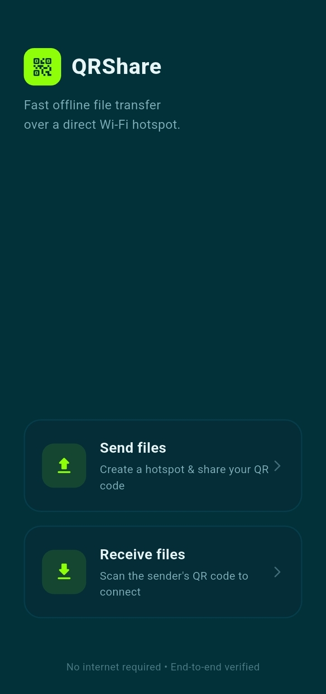
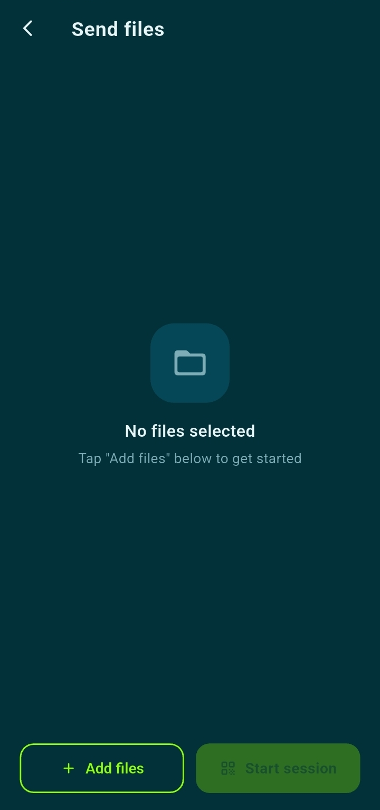
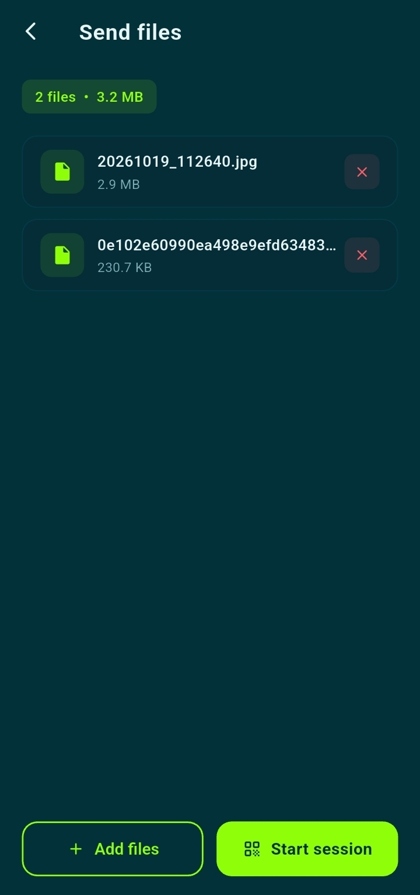
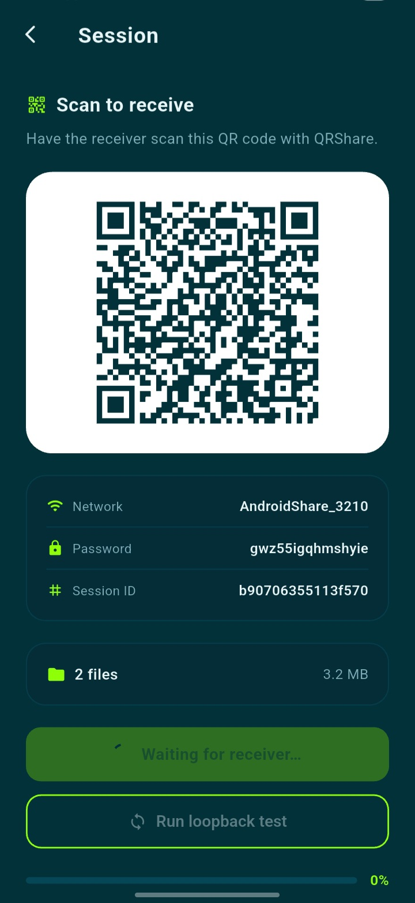

# qrshare

> **Author:** Beza Mitiku &nbsp;|&nbsp; **ID:** CTC-812-16 &nbsp;|&nbsp; **Stream:** Development

qrshare is an Android app that sends files straight from one phone to another
without the internet. There is no server in the middle and nothing to sign up
for. One phone turns itself into a small local Wi-Fi hotspot, the other phone
joins it, and the files travel directly between the two.

## Screenshots

| Home | No files selected |
| --- | --- |
|  |  |

| Files selected | Session QR code |
| --- | --- |
|  |  |

## How it works

1. On the sending phone, you pick the files you want to send and start a session.
   The app creates a local-only Wi-Fi hotspot and shows a QR code on screen.
2. On the receiving phone, you scan that QR code. It contains the hotspot name,
   the password, and a session id.
3. The receiving phone joins the hotspot automatically and connects to the sender.
4. The sender streams each file over a simple TCP protocol. Every file is checked
   with a SHA-256 hash before it is accepted, so a corrupted or incomplete
   transfer is rejected rather than saved.
5. Verified files are saved to the receiving phone's Downloads folder, where they
   can be opened or shared like any other file.

Because the hotspot is local-only, it never touches a mobile network or the wider
internet. The two phones talk to each other and nothing else.

## How to use

You need two Android phones with qrshare installed. Decide which one will send
and which one will receive. The sender starts the session; the receiver scans.

### On the sending phone

1. Open qrshare and tap **Send**.
2. Tap **Select files** and choose one or more files. They appear in a list, and
   you can remove any you picked by mistake.
3. Tap **Start session**, allow the Wi-Fi permission when asked, then tap
   **Start hotspot**.
4. A QR code appears, along with the hotspot name and password. Leave this screen
   open.
5. Tap **Wait for receiver**. The screen shows that it is waiting.
6. When the other phone connects, the message changes to **Receiver connected** and
   a progress bar fills as the files are sent.
7. When it finishes, the screen confirms that the transfer completed and the
   hashes matched.

### On the receiving phone

1. Open qrshare and tap **Receive**.
2. Point the camera at the QR code on the sending phone.
3. Once the QR code is recognised, the session details appear. Tap
   **Connect & receive**.
4. Android asks whether to connect to the sender's hotspot. Allow it.
5. The app connects and downloads the files, showing progress as it goes.
6. When it finishes, the files are listed with their sizes. Tap the open button to
   view a file, or the share button to send it on to another app.

Received files are stored in the phone's **Downloads** folder. Each file is
checked by hash, so the saved copy is identical to the original.

### Tips

- Keep both phones close to each other and keep the app in the foreground until
  the transfer finishes.
- If the receiver cannot find the hotspot, make sure the sender's hotspot is still
  running.
- If a transfer is interrupted, start a new session and try again.

## Strengths

- Works with no Wi-Fi network, no router, and no mobile data.
- Nothing leaves the two devices, so there is no cloud or account involved.
- Verifies every file by hash, so what arrives is what was sent.
- Handles multiple files in one session and shows progress on both ends.

## Requirements

- Android 10 (API 29) or newer on both phones.
- Both phones need a working Wi-Fi chip. Camera access is needed on the receiving
  phone to scan the QR code.
- The sending phone must be allowed to create a hotspot. Some devices and carriers
  do not permit this.

## Limitations

- Android only. The networking and hotspot parts are written specifically for
  Android and there is no iOS version.
- The connection is short range, since it relies on a local hotspot.
- A transfer can be interrupted if either phone locks or the app is closed.

## How it is built

The app is written in Flutter for the interface and the transfer logic, with a
small amount of Kotlin for the Android-specific parts (creating and joining the
Wi-Fi hotspot, and saving files to Downloads).

- Flutter and Dart for the UI, file picker, and the TCP transfer protocol.
- A custom length-prefixed frame protocol for sending file data.
- SHA-256 hashing to confirm each file arrived intact.
- `mobile_scanner` for reading QR codes and `qr_flutter` for generating them.
- Kotlin platform channels for `WifiManager` and `MediaStore`.

## Building

Clone the repository and run it on a connected Android device:

```
flutter pub get
flutter run
```

To build a release APK:

```
flutter build apk --release
```
